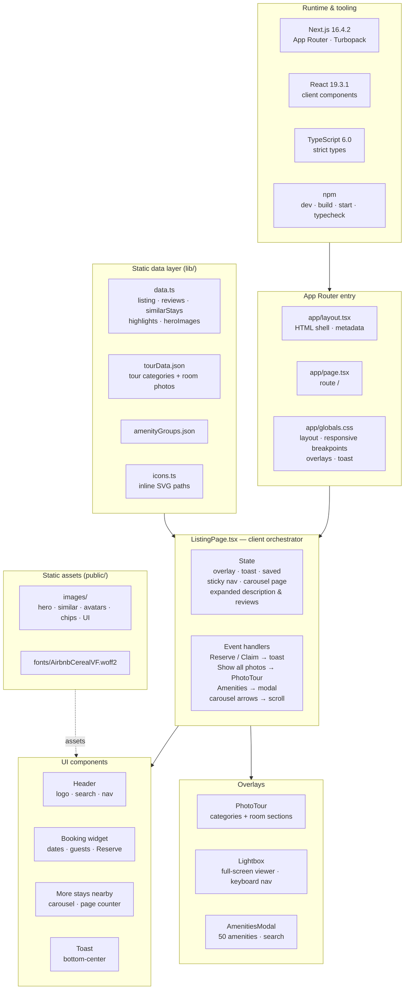

# Excalidraw AI prompt — Airbnb Listing Clone architecture

Paste the block below into **Excalidraw → "Generate diagram with AI"** (or any
text-to-diagram tool). It describes the finished diagram that ships alongside
this file as `architecture-diagram.pdf` / `.png` / `.svg`.

If the generator prefers Mermaid, use the small Mermaid version at the end.

Resulting Excalidraw export: `docs/architecture-diagram-excalidraw.png`.

---

## Prompt (copy from here)

Draw a clean, professional software architecture diagram for a Next.js front-end
project. Use a **top-to-bottom layered layout** on a white background, thin
1px light-grey borders, rounded-corner containers, and one soft pastel header
band per group. All arrows are thin grey arrows (about 1px, small arrowheads).
Keep generous spacing; no shadows, no gradients.

The diagram has seven groups of boxes plus three relationship arrows.

**1. Top layer — "Runtime & tooling"** (light grey header, 4 cells in one row):
- "Next.js 16.4.2 / App Router · Turbopack"
- "React 19.3.1 / client components"
- "TypeScript 6.0 / strict types"
- "npm / dev · build · start · typecheck"

**2. Second layer — "App Router entry"** (light blue header, 3 cells in one row):
- "app/layout.tsx / HTML shell · metadata"
- "app/page.tsx / route /"
- "app/globals.css / layout · responsive breakpoints / overlays · toast"

**3. Middle-left — "Static data layer (lib/)"** (light slate header, 4 stacked cells):
- "data.ts / listing · reviews · similarStays / highlights · heroImages"
- "tourData.json / tour categories + room photos"
- "amenityGroups.json / amenity groups"
- "icons.ts / inline SVG paths / used by UI components"

**4. Middle-centre — "ListingPage.tsx — client orchestrator"**
(light amber/peach header, then two cells side by side):
- Left cell, heading "State": "overlay (photo tour / lightbox / amenities),
  toast message, saved, sticky nav, carousel page, expanded description & reviews"
- Right cell, heading "Event handlers": "Reserve / Claim → toast,
  Show all photos → PhotoTour, Amenities → modal, carousel arrows → scroll"

**5. Middle-right — "Static assets (public/)"** (light teal header, 2 stacked cells):
- "images/ / hero · similar · avatars / chips · UI icons"
- "fonts/AirbnbCerealVF.woff2"

**6. Bottom-left / centre — "UI components"** (light green header, 4 cells in one row):
- "Header / logo · search · nav"
- "Booking widget / dates · guests · Reserve"
- "More stays nearby / carousel · page counter"
- "Toast / bottom-center"

**7. Bottom-right — "Overlays"** (light purple header, 3 stacked cells):
- "PhotoTour / categories + room sections"
- "Lightbox / full-screen viewer · keyboard nav"
- "AmenitiesModal / 50 amenities · search"

**Arrows (solid, grey, with labels — data/control flow):**
1. "Runtime & tooling" → down → "App Router entry"
2. "App Router entry" → down → "ListingPage.tsx — client orchestrator"
3. "Static data layer (lib/)" → right → "ListingPage.tsx — client orchestrator"
4. "ListingPage.tsx — client orchestrator" → down → "UI components"
5. "ListingPage.tsx — client orchestrator" → down-right → "Overlays"

**Arrows (dashed, lighter grey — asset dependency):**
6. "Static assets (public/)" → down → "UI components", labelled "assets"

**Style notes**
- Titles: bold, 14–16px, dark charcoal (#1f2328); body text 12–13px grey-black.
- Header bands: #eceff3 (runtime), #e8f0fb (entry), #f2ecfa (overlays),
  #eaf5ec (UI), #fdf1e3 (ListingPage), #eef2f6 (data), #e9f6f5 (assets).
- Body cells: pure white.
- Emphasise "ListingPage.tsx — client orchestrator" slightly more than the rest
  (thicker border, or a coral accent line) because it is the heart of the app.
- Add a short caption under the diagram:
  "app/page.tsx → components/ListingPage.tsx → lib/ data · public/ assets".
- Add a tiny legend: solid line = "control / data flow", dashed line = "asset dependency".

---

## Same diagram as Mermaid (paste into an AI that prefers Mermaid)

